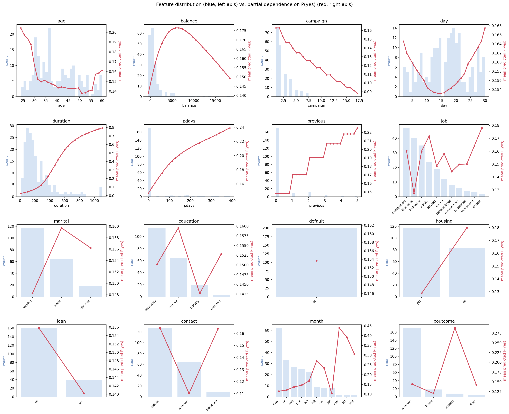
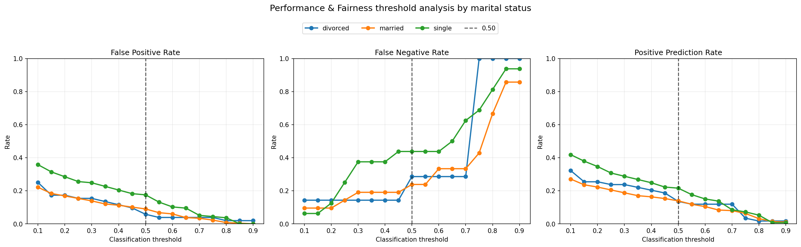

# Bank Marketing ML Pipeline: Validation and Model Analysis

A team project completed for COMP-315 AI Software Testing at Centennial College in Summer 2026.

This project implements a TensorFlow Extended (TFX) pipeline with Apache Airflow orchestration to predict term-deposit subscriptions using the UCI Bank Marketing dataset. It focuses on validating data, evaluating models, examining subgroup performance, and interpreting predictions.

## Project Highlights

- Built interactive and Airflow-based TFX workflows covering data ingestion through model export.
- Validated dataset structure using statistics, inferred schemas, and anomaly detection.
- Trained a TensorFlow binary classifier with numerical features and categorical embeddings.
- Evaluated overall and marital-status subgroup performance using TensorFlow Model Analysis (TFMA).
- Compared two model runs and examined trade-offs between precision and recall.
- Used the What-If Tool (WIT), partial dependence plots, and threshold analysis to investigate predictions.
- Applied model-quality thresholds before exporting an approved model.

## Pipeline Components

| Component | Purpose |
|---|---|
| CsvExampleGen | Ingest prepared CSV data and generate train/eval splits |
| StatisticsGen | Compute feature statistics |
| SchemaGen | Infer feature types and categorical domains |
| ExampleValidator | Check data against the inferred schema |
| Transform | Standardize numerical features, bucket age, and encode categories |
| Trainer | Train the classifier and export a SavedModel |
| Resolver | Retrieve the latest approved model as an evaluation baseline |
| Evaluator | Compute metrics and validate model-quality thresholds |
| Pusher | Export an approved model to a local serving-model directory |

The Airflow DAG is manually triggered using `schedule_interval=None`.

Model export is the final implemented deployment-preparation step.

## Implementation Structure

`bank_marketing_dag.py` defines the Airflow pipeline and is the reference implementation for its evaluation settings.

`bank_marketing_tfx_walkthrough.py` constructs the components interactively for development and inspection.

`pipeline.py` provides a separate reusable pipeline definition. The Airflow DAG defines its own pipeline rather than importing this function.

| Evaluation setting | Airflow DAG | Separate pipeline module |
|---|---:|---:|
| Minimum binary accuracy | 0.70 | 0.50 |
| Maximum absolute accuracy decrease from baseline | 0.01 | 0.001 |

Both use marital status for sliced evaluation. When no baseline model exists, the absolute accuracy requirement still applies.

## Recorded Evaluation Results
[View the project report](docs/bank_marketing_project_report_public.pdf)

The following values are transcribed from the TFMA screenshot in Figure 5.1 on page 12 of the submitted report. They describe that recorded evaluation run.

| Metric | Value |
|---|---:|
| Evaluation examples | 15,088 |
| Binary accuracy | 0.87957 |
| ROC AUC | 0.91545 |
| Precision | 0.48774 |
| Recall | 0.71437 |

The report also contains a two-run comparison with slightly different values. Those records are treated separately from the screenshot above.

Recorded execution evidence includes an Airflow task graph with successful task states, a successful Trainer log, TensorBoard curves, TFMA dashboards, WIT analyses, and model approval/export output.

## Analysis and Findings

### Data validation

The prepared dataset contains 45,211 records with 16 input features and one target column. Recorded ExampleValidator results show no detected anomalies in either split.

Values such as `unknown` remain valid categorical values. Passing schema validation does not establish that every feature is informative or suitable for the intended application.

### Model evaluation

The target is strongly imbalanced, making accuracy alone insufficient for assessing performance.

TFMA slicing examines married, single, and divorced customer groups. The analysis identifies differences across metrics rather than treating one group as consistently weakest.

### Interpretability

WIT uses 500 sampled evaluation examples for prediction inspection and group analysis. The static partial dependence plots use a subset of 200 examples.

Threshold analysis examines changes in false positive rates, false negative rates, and positive prediction rates across marital-status groups.

Contrasting examples and partial dependence show model behavior and associations. They do not establish causal effects.

## Dataset and Attribution

Source: [UCI Bank Marketing](https://archive.ics.uci.edu/dataset/222/bank+marketing)

Citation: Moro, S., Rita, P., & Cortez, P. (2014). *Bank Marketing* [Dataset]. UCI Machine Learning Repository. https://doi.org/10.24432/C5K306

Dataset license: [Creative Commons Attribution 4.0 International](https://creativecommons.org/licenses/by/4.0/)

Preparation applied to `bank-full.csv`:

- Converted the semicolon-delimited source to comma-delimited CSV.
- Converted target values from `yes` and `no` to `1` and `0`.
- Retained the source rows and input feature values.

The dataset license applies to the dataset and does not determine the license of the project code.

## Environment and Execution Context

Key versions specified in `requirements.txt`:

| Package | Version |
|---|---|
| TFX | 1.12.0 |
| TensorFlow | 2.11.0 |
| Apache Airflow | 2.2.5 |
| TensorFlow Model Analysis | 0.43.0 |
| TensorFlow Data Validation | 1.12.0 |
| TensorFlow Transform | 1.12.0 |
| What-If Tool widget | 1.8.1 |

TFX 1.12.0 supports Python versions `>=3.7,<3.10`.

The walkthrough and analysis files are Python exports of Jupyter notebooks. They contain IPython features, display expressions, and interactive widgets that require a compatible notebook environment.

The workflows have different roles:

1. The interactive walkthrough prepares data and runs TFX components.
2. The Airflow DAG orchestrates its own pipeline configuration.
3. TFMA analysis loads evaluation artifacts from previous interactive runs and requires two runs for comparison.
4. WIT analysis loads evaluation examples and a pushed SavedModel from the interactive workflow.

Pipeline artifacts and trained models are generated outputs and are not included in the submitted source package.

## Repository Files

| Path | Contents |
|---|---|
| `bank_marketing_dag.py` | Airflow pipeline definition |
| `pipeline.py` | Separate reusable pipeline definition |
| `transform_module.py` | Feature transformation |
| `trainer_module.py` | Training and SavedModel export |
| `bank_marketing_tfx_walkthrough.py` | Interactive workflow export |
| `TFMA_analysis_bank_marketing.py` | TFMA analysis export |
| `What-if-Tool-analysis.py` | WIT, PDP, and threshold analysis export |
| `data/raw/bank-full.csv` | Source dataset |
| `data/bank_marketing/bank_data.csv` | Prepared dataset |
| `docs/images/` | Recorded analysis plots |
| `requirements.txt` | Specified dependency versions |

## Analysis Plots

### Feature Distributions and Partial Dependence

### Threshold Analysis by Marital Status

## Limitations

- Call duration is available after a call and is unsuitable for pre-call targeting.
- The dataset comes from one Portuguese bank and may not generalize to other settings.
- Marital-status analysis covers one subgroup dimension and does not establish overall model fairness.
- WIT findings are exploratory and based on a sample.
- Demonstration approval thresholds are not derived from formal business requirements.
- A local model export does not establish production readiness.

## Team Project Context

This repository presents work completed collaboratively for a course project. It documents the team's implementation and recorded results.